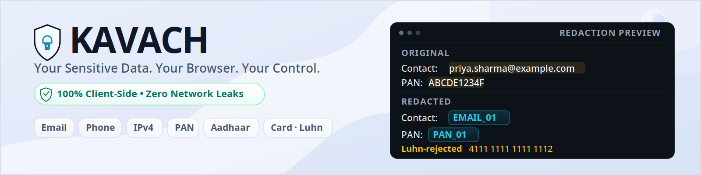

<p align="center"></p>

# KAVACH

**Your Sensitive Data. Your Browser. Your Control.**

A 100% client-side PII redactor that detects, validates, redacts, and exports sensitive personal data locally—nothing leaves your browser.

[](https://kavach-three-umber.vercel.app/)


---

## Live Demo

Try it live: **[https://kavach-three-umber.vercel.app/](https://kavach-three-umber.vercel.app/)**

### Try it in 60 seconds
1. Click **Load Sample Data** to populate multi-category test input.
2. Pick a redaction mode (**Full Mask**, **Partial Mask**, or **Consistent Pseudonymization**).
3. Click **Redact** to process the input locally.
4. Inspect the inline **diff** and per-category **counts** (including Luhn-rejected card candidates).
5. Click **Export** to download the redacted `.txt` or `.csv` file.
6. Open **Self-Test Suite** and click **Run All Tests** to verify all 61 built-in checks.
7. Open **Privacy & Audit Logs** to inspect operational metadata (zero raw PII logged).

---

## What It Detects

All detectors and validators are implemented deterministically in [`src/core/detectors.js`](./src/core/detectors.js) and [`src/core/validators.js`](./src/core/validators.js):

| Category | Detection & Validation Rules |
|---|---|
| **Emails** | RFC-style `local@domain` matching (`1–64` char local part without leading/trailing/consecutive dots; `1–253` char domain with at least one dot and `2+` char TLD); trims trailing sentence punctuation (`.,;:!?)"'>`). |
| **Phones** | **Indian Mobile:** optional `+91` / `91` / `0` prefix + 10 digits starting with `6–9`. **International:** E.164-like `+` country prefix with `8–15` total digits. Rejects date/timestamp contexts and alphanumeric-embedded numbers. |
| **IPv4** | 4 decimal octets (`0–255`), strict digit/dot boundary checks, rejects leading zeros, negative octets, and software version prefixes (e.g., `v1.2.3.4`, `release-2.3.4.5`). |
| **PAN** | Case-insensitive `[A-Z]{5}[0-9]{4}[A-Z]` normalized to uppercase with strict alphanumeric word-boundary isolation. |
| **Aadhaar** | 12-digit candidate starting with `2–9` (continuous or `4-4-4` space/hyphen grouping), validated with the Dihedral Group D5 Verhoeff checksum (`validateVerhoeff`). |
| **Credit Cards** | 13–19 digits (optional spaces/hyphens), validated via ISO/IEC 7812-1 modulus 10 Luhn checksum (`validateLuhn`). Luhn-failing candidates are reported separately and **not** redacted or counted as valid cards. |

Overlapping findings are resolved deterministically (`start` ascending, span length descending, type priority descending) over half-open intervals `[start, end)` so no character is ever double-redacted.

---

## Redaction Modes

- **Full Mask:** Replaces each finding with a typed marker (e.g., `[REDACTED_EMAIL]`, `[REDACTED_CREDIT_CARD]`).
- **Partial Mask:** Reveals only configured safe portions (e.g., `u***@e******.com`, last 4 digits for cards/Aadhaar/phones, first two octets for IPv4).
- **Consistent Pseudonymization:** Maps normalized values to deterministic, run-scoped tokens (e.g., `EMAIL_01`, `CARD_01`); identical values within a run map to the same token across text and CSV cells.

---

## Inputs & Outputs

- **Inputs:** Direct typing/pasting, `.txt` and `.csv` file upload (click or drag-and-drop).
- **CSV Engine:** RFC-4180 state-machine parser supporting quoted commas, escaped quotes (`""`), and embedded newlines, plus spreadsheet formula-injection defense (prepends `'` to cells starting with `=`, `+`, `-`, `@`, `\t`, or `\r`).
- **Outputs:** Side-by-side original vs. redacted panes, XSS-safe inline diff, per-category detection counts, `.txt`/`.csv` download of the redacted output, and a privacy-safe activity log.

---

## Privacy by Design

- **Zero runtime dependencies** and **no network calls**: all detection, validation, and redaction execute strictly inside browser RAM.
- **No browser storage:** never writes to `localStorage`, `sessionStorage`, `IndexedDB`, or cookies.
- **XSS-safe rendering:** user-derived text is rendered exclusively via DOM text nodes (`textContent`), never unsafe `innerHTML`.
- **Privacy-safe logs:** activity logs record only timestamps, operation types, categories, modes, and aggregate counts—never raw PII.
- Verified automatically via `npm run lint:privacy` (a static audit in [`test/privacy-audit.js`](./test/privacy-audit.js)).

---

## Run Locally

```powershell
git clone https://github.com/nikhilkunte645-maker/KAVACH.git
cd KAVACH
python -m http.server 8000
```

Open **http://localhost:8000** in your browser.

> **Note:** Opening `index.html` directly by double-clicking (`file://`) will not work because browser ES modules require an HTTP server.

---

## Scripts & Verification

```powershell
npm test             # Unit, CSV, integration, a11y & security tests (36 cases)
npm run test:self    # 61 built-in self-tests across categories A–K
npm run typecheck    # Strict TypeScript static type checking (tsc --noEmit)
npm run lint:privacy # Static privacy & zero-network audit
npm run test:performance # Reproducible 100 KB–5 MB performance benchmarks
npm run build        # Validates & copies production assets to dist/
```

---

## Project Structure

```text
KAVACH/
├── assets/
│   └── kavach-banner.png
├── components/
│   └── ui/
├── lib/
│   └── utils.ts
├── scripts/
│   └── build.js          # Production asset builder (outputs dist/)
├── src/
│   ├── app.js            # UI controller & DOM event wiring
│   ├── core/             # Detectors, validators (Luhn/Verhoeff), overlap, redactor, CSV, diff, logger, state, engine
│   └── self-test/        # 61 self-test cases & runner
├── test/                 # Unit tests, CSV tests, CLI self-test runner, privacy audit
├── index.html
├── style.css
├── globals.css
├── package.json
├── tsconfig.json
└── vercel.json
```

---

## Deployment

Configured as a static site on Vercel via [`vercel.json`](./vercel.json):
- **Build Command:** `npm run build`
- **Output Directory:** `dist`

---

## Limitations

Detection is rule-based (regular expressions plus Luhn/Verhoeff checksum validation) and is not guaranteed to be exhaustive for all formats or edge cases. Always review the redacted output before sharing.

---

## Author

Created by **[nikhilkunte645-maker](https://github.com/nikhilkunte645-maker)**.
